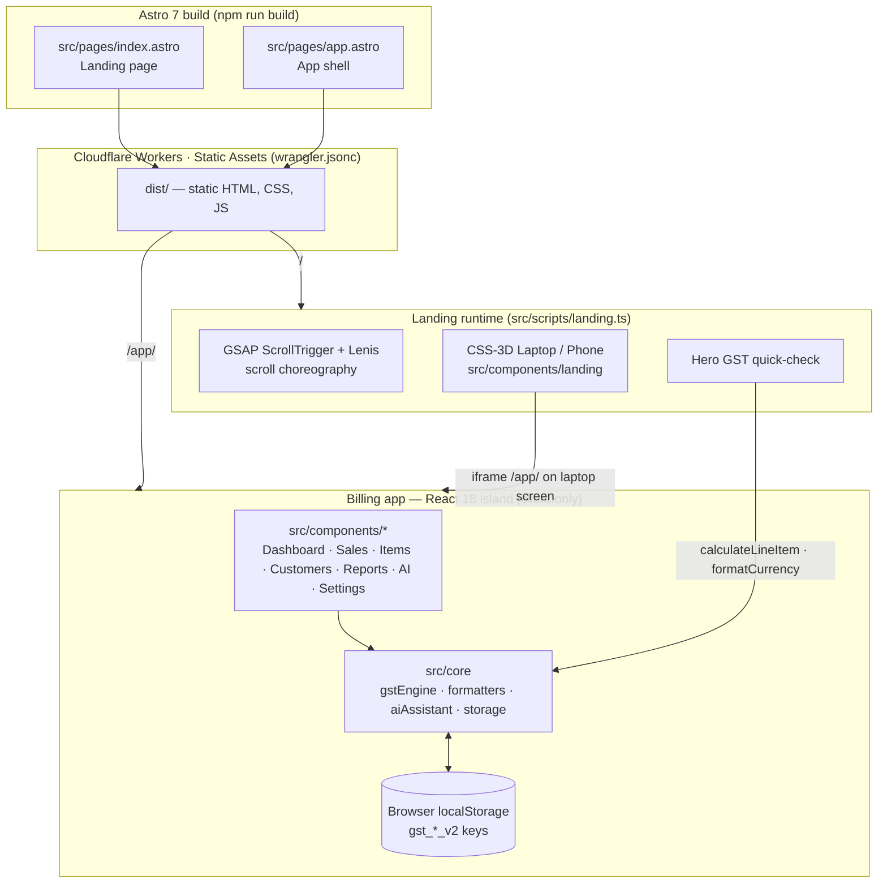

<div align="center">


# PayzenMax

**Offline-ready GST billing & business platform for Indian counters**

CBIC Rule 46 tax invoices · Automatic CGST / SGST / IGST · GSTR-1 ready reports · Grounded AI assistant

<p>
  
  
  
  
  
  <br />
  
  
  
  
  
</p>

<p>
  &nbsp;&nbsp;
  &nbsp;&nbsp;
  &nbsp;&nbsp;
  &nbsp;&nbsp;
  &nbsp;&nbsp;
  &nbsp;&nbsp;
  
</p>

[Overview](#-overview) · [Architecture](#-architecture) · [Tech stack](#-tech-stack) · [Getting started](#-getting-started) · [Deploy](#%EF%B8%8F-deploy-to-cloudflare) · [Features](#-implemented-core-capabilities)

</div>

---

## 📖 Overview

PayzenMax is an India-first billing and business-visibility platform for small traders, service businesses and counter operators, built from the 30 October 2026 PRD. It has two parts, shipped from one Astro project:

| Route | What it is | Source |
|---|---|---|
| **`/`** | Marketing landing page — scroll-driven 3D laptop running the live app, pinned feature story, 3D phone preview, hero GST quick-check, testimonials, footer | `src/pages/index.astro` |
| **`/app/`** | The billing app (React MVP) — invoices, items, customers, GSTR-1 reports, AI assistant | `src/pages/app.astro` → `src/App.tsx` |

Everything runs in the browser. There is **no backend and no login**: business data lives in `localStorage` on the user's device.

---

## 🏗 Architecture



**Key design decisions**

- **Static-first.** Astro outputs plain HTML/CSS/JS (`output: "static"`), so the site deploys anywhere — here to Cloudflare Workers Static Assets with no server code.
- **The MVP is untouched.** `src/pages/app.astro` mounts the existing `App` component as a `client:only="react"` island, because the app depends on browser storage.
- **One GST engine.** `src/core/gstEngine.ts` is shared: the app uses it for invoices, and the landing page's hero calculator imports the same `calculateLineItem` and `formatCurrency`, so marketing numbers always match real invoices.
- **Live product on the landing page.** The 3D laptop's screen is a same-origin iframe of `/app/`. Scrolling through features switches the app's sidebar tab; visitors can click in and use it with demo data.
- **Progressive motion.** Desktop (≥1024px) gets the pinned 3D story; small screens and `prefers-reduced-motion` get a static, fully readable layout.

### Data model & storage

| Key | Contents |
|---|---|
| `gst_business_profile_v2` | Seller profile, GSTIN, state, invoice series |
| `gst_customers_v2` | Customer master with GSTIN & balances |
| `gst_items_v2` | Goods / services with HSN/SAC, GST slab, stock |
| `gst_invoices_v2` | Issued invoices, drafts, credit notes (immutable snapshots) |
| `gst_audit_logs_v2` | Audit trail of every change |
| `gst_initialized_v2` | Demo-data seed flag |

### Project structure

```text
gstbillings/
├── astro.config.mjs          # Astro + React integration, dev server on :5173
├── wrangler.jsonc            # Cloudflare Workers Static Assets config
├── tailwind.config.js        # Brand tokens (canvas, green, sage…) + Inter / Manrope fonts
├── public/
│   └── favicon.svg           # Logo
└── src/
    ├── pages/
    │   ├── index.astro       # Landing page  →  /
    │   └── app.astro         # Billing app   →  /app/
    ├── components/
    │   ├── landing/          # Laptop.astro, Phone.astro (CSS-3D devices)
    │   ├── Dashboard/  Sales/  Items/  Customers/
    │   ├── Reports/  AIAssistant/  Settings/  Layout/
    ├── core/
    │   ├── gstEngine.ts      # Deterministic, paise-exact GST calculation
    │   ├── formatters.ts     # ₹ formatting, amount in words, GSTIN validation
    │   ├── aiAssistant.ts    # Grounded Q&A over the books
    │   └── storage.ts        # localStorage persistence + demo seed
    ├── scripts/landing.ts    # GSAP / Lenis scroll choreography, phone & calculator logic
    ├── styles/landing.css    # Landing page styles
    ├── types/index.ts        # Domain types
    ├── App.tsx  main.tsx  index.css
```

---

## 🛠 Tech stack

| Layer | Technology | Version |
|---|---|---|
| Framework / build | [Astro](https://astro.build) (bundles Vite) | 7.4.4 |
| UI integration | @astrojs/react | 7.1.2 |
| App UI | React · React DOM | 18.3.1 |
| Language | TypeScript | 5.9.3 |
| Styling | Tailwind CSS · PostCSS · Autoprefixer | 3.4.19 · 8.5.32 · 10.6.2 |
| Class utilities | clsx · tailwind-merge | 2.1.1 · 2.6.1 |
| Icons | lucide-react | 1.66.0 |
| Scroll animation | GSAP (ScrollTrigger) | 3.15.0 |
| Smooth scrolling | Lenis | 1.3.27 |
| Deploy / edge | Cloudflare Workers Static Assets · Wrangler | 4.156.0 |
| Runtime (dev) | Node.js · npm | 26.7.0 · 11.19.0 |

**Typography:** Manrope 700/800 (headings) · Inter 400–600 (body, buttons, app UI) · IBM Plex Mono (GSTIN / HSN / amounts) · Caveat (hero handwritten note).

**Brand palette:** canvas `#F6F6F3` · ink `#17181A` · green `#1B5E3B` · sage `#7FB396` · blue `#2E5AAC` · amber `#A14A0B`.

---

## 🚀 Getting started

**Requirements:** Node.js ≥ 22.23.4 (Cloudflare builds use 24, see `.nvmrc`) and npm 10+.

```bash
git clone https://github.com/Sujoymoulick/PAYZENMAX.git
cd PAYZENMAX
npm install
npm run dev
```

- Landing page: <http://localhost:5173/>
- Billing app: <http://localhost:5173/app/>

### Scripts

| Command | What it does |
|---|---|
| `npm run dev` | Astro dev server with HMR on port 5173 |
| `npm run build` | Type-check (`tsc --noEmit`) and build static site into `dist/` |
| `npm run preview` | Serve the production build on port 4173 |
| `npm run cf:dev` | `wrangler dev` — builds, then serves on the local Cloudflare Workers runtime (port 8787) |
| `npm run deploy` | `wrangler deploy` — runs `npm run build` (via `build.command` in `wrangler.jsonc`), then deploys |

---

## ☁️ Deploy to Cloudflare

The site is served by **Cloudflare Workers Static Assets** (`wrangler.jsonc` → `assets.directory: ./dist`).

```bash
npx wrangler login     # once, opens the browser
npm run deploy         # astro build + wrangler deploy
```

**Git-connected Workers Builds:** push to `main` and Cloudflare runs `npm ci` then `npx wrangler deploy`, which builds the site itself through `build.command` — no extra build command needed in the dashboard.

It goes live at `payzenmax.<your-subdomain>.workers.dev`. Add a custom domain under the Worker's **Domains & Routes** in the Cloudflare dashboard.

---

## 🌟 Implemented core capabilities

### 1. Local-first & online setup
- **No mandatory login:** Business profile, masters and invoices persist directly in browser storage (`localStorage` / offline-first).
- **CBIC validation:** 15-character GSTIN validation (`27AABCV1234F1Z8`) with automatic state code extraction.
- **Configurable series:** Sequential 16-character maximum invoice numbering (e.g. `VT/26-27/0108`) complying with Indian GST rules.

### 2. Deterministic GST calculation engine (`src/core/gstEngine.ts`)
- **Integer paise arithmetic:** Zero binary floating-point drift (`Math.round(val * 100)`).
- **Intra-state vs. inter-state detection:**
  - Intra-state (seller state == buyer state): splits tax evenly into **CGST** and **SGST**.
  - Inter-state (seller state != buyer state): applies **IGST**.
- **Tax modes:** Line-level support for tax-exclusive and tax-inclusive pricing.
- **Mandatory HSN aggregation:** Generates Table 12 HSN summaries with rate-wise taxable values and tax splits.
- **Automatic round-off:** Rounds grand total to the nearest whole rupee with a transparent round-off adjustment.

### 3. Fast counter billing & invoicing (`src/components/Sales/InvoiceComposer.tsx`)
- **Keyboard-optimised:** New bill (`Alt+N`), quick add line items (`Alt+A`), issue bill (`Alt+Enter`), quick customer creation modal.
- **Live stock alerts:** Real-time indicator when goods are below reorder threshold.
- **Payment collection:** Cash, UPI, bank IMPS/NEFT or cheque with transaction reference, or mark as credit (unpaid).

### 4. CBIC Rule 46 compliant printable tax invoice (`src/components/Sales/PrintableTaxInvoice.tsx`)
- **Standard layout:** Original for Recipient, Duplicate for Transporter, Triplicate for Supplier.
- **Legal requirements:** Supplier & buyer GSTIN, state codes, place of supply, reverse-charge flag, HSN summary table.
- **Indian numbering words:** Full amount in Indian English (e.g. *Rupees Fourteen Thousand Six Hundred Eighty-Three Only*).
- **Bank & UPI QR code:** Standard `upi://pay?pa=...` QR code for instant counter scanning.
- **Clean print stylesheet:** `@media print` optimised for single-sheet A4 output without UI clutter.

### 5. Document integrity & immutability (FR-3 & FR-4)
- **Immutable snapshots:** Issued invoices cannot be silently modified or renumbered.
- **Cancellation workflow:** Voids an invoice with a mandatory reason, reverses customer balances and restores stock.
- **Credit note workflow:** Issues linked credit notes with tax reversal calculations.

### 6. Owner visibility & explainable reports (FR-5)
- **Period filtering:** Today, This Week, This Month, FY 2026-27.
- **Explainable metrics:** Click any metric (Sales, GST, Receivables) to open the **Drilldown Modal** with the exact formula, filters and underlying invoices.
- **GSTR-1 ready reports:**
  - Table 4: B2B registered invoices
  - Table 7: B2C small consumer supplies
  - Table 12: HSN summary of outward supplies
  - Complete sales register (CSV export)
  - Receivables aging report

### 7. Grounded AI business assistant (Beta — FR-8 & FR-9)
- **Deterministic Q&A:** Answers strictly by querying real transaction books:
  - *"How much did I sell this month?"*
  - *"Who hasn’t paid me and which bills are overdue?"*
  - *"What are my top selling items?"*
  - *"How much GST liability do I have?"*
  - *"Which items are running low on stock?"*
- **Clickable citations:** Every answer links to the exact underlying transactions.
- **Push-to-talk voice simulator:** Speech-to-text input with an editable transcript before submitting.

### 8. Backup & portability (FR-7)
- **Export backup:** One-click encrypted JSON database download.
- **Restore:** Restore the database from backup JSON with structure validation.
- **Demo data seed / reset:** One click to reset to realistic sample business records.

### 9. Landing page (`/`)
- **3D laptop hero** whose screen runs the live app; the lid opens on load and closes on scroll.
- **Pinned feature story** (GSAP ScrollTrigger): the laptop slides aside and stays put through six feature sections, switching app tabs and callout chips.
- **Laptop → phone hand-off:** the lid closes, the laptop parks and an interactive 3D phone preview (Home / Bill & UPI collect / Ask) rises.
- **Hero extras:** word-by-word animated description, handwritten note with a self-drawing arrow, and a live GST quick-check powered by the app's engine.
- **Accessible fallback:** static layout on small screens and for `prefers-reduced-motion`.

---

<div align="center">


**PayzenMax.com** · GSTIN-aware · Paise-exact · Made in India

</div>
